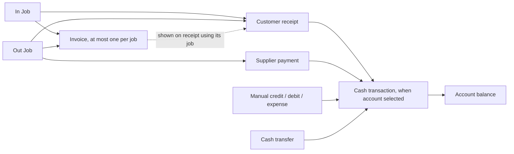

# Payment and accounting field review

## Current links

Customer receipts and supplier payments are now visible as sources in the **Cash Book** when they have a cash account. Finance-authorized users can open the related payment list filtered to that job. Transfers now link both cash movement rows back to their transfer record. Receipt lists show the job, customer or supplier, invoice, method, account, and recorder.

Quotations are not yet connected to an invoice, payment, or Pipeline job. The practical path is to create the Pipeline/production job, then invoice and pay against that job. Marking a quotation Accepted alone does not create an accounting receivable.

## Field assessment

| Record | Needed for a reliable posting | Useful supporting data | Optional / conditional | Current gap |
| --- | --- | --- | --- | --- |
| Customer receipt | Job, positive amount, date, payment channel, cash/bank account, recorder | Invoice number (resolved through the linked job), receipt reference, payment stage (advance/interim/balance) | Reference can be blank for physical cash; require it for UPI, bank transfer, card, or cheque | Cash account and method are optional today. Payments without an account update the job balance but do not appear in the Cash Book. |
| Supplier payment | Out Job, supplier/payee, positive amount, date, payment channel, source account, recorder | Bank/UPI/cheque reference, supplier invoice number and attachment | Reference may be omitted for physical cash | Supplier invoice number and proof of payment are not captured. Cash account and method are optional today. |
| Invoice | Job, unique invoice number, issue date, taxable amount, GST rate, customer snapshot | Due date, tax registration/address snapshot, terms, PDF/print copy | GST details depend on the customer's tax treatment | Payments link to the job, not the invoice row itself. Since one Invoice is allowed per job, the receipt can currently display that invoice, but there is no allocation schedule or outstanding-by-invoice ageing. |
| Manual Finance entry | Type, date, account, positive amount, description, recorder, idempotency key | Category, supplier/payee, supporting receipt/expense document, external reference | Supplier is optional when unrelated to a supplier | Expense category and proof are optional; no job link exists, so avoid duplicating a job expense here without a clear policy. |
| Cash transfer | Source account, destination account, date, amount, reason, recorder | Bank transfer reference | — | Transfer movements now link to the transfer record and show account names in the transfer list. |

## Keep, require, and avoid

- Keep the job link, amount, transaction date, recorder, and cash/bank account as core fields. They answer who paid, what was settled, when money moved, who entered it, and where the money went.
- Make payment channel consistent (Cash, Bank Transfer, UPI, Card, Cheque, Other) instead of free text. Require an external reference for non-cash methods where a reference exists.
- For reliable cash/bank reconciliation, require a cash account on live Customer and Supplier payment forms. Before enforcing this server-side, add a cash-account choice to job creation when users enter opening advances. Existing opening advances are recorded as payment history without a CashTransaction because those forms have no account field; reconcile these separately.
- Capture supplier invoice number and attach the supplier invoice to an Out Job or Supplier Payment. Keep supplier invoice amount separate from the amount paid so outstanding supplier balances can be aged.
- Add invoice due date and a clear source-of-truth rule between the invoice grand total and job customer total before building ageing reports. The current app has both values and does not automatically reconcile them.
- Keep manual Finance entries for non-job receipts and expenses. For a customer receipt or supplier settlement, use its dedicated payment form so job balances update. Entering the same movement in Finance as well would double-count cash.
- Do not ask staff to enter job IDs manually when a searchable job selector is available. The API's job kind plus job ID is a technical discriminator; it can remain behind the single job selector.
- `balance_after`, `payment_status`, and job `advance` are calculated/cached values. Display them for review, but do not allow staff to type them as independent accounting facts. The Cash Book balance is the transaction snapshot; the job balance is the amount still due.
- `updated_at` adds little accounting value on append-only payment rows. Preserve `created_at` and `recorded_by` as the audit trail; correct mistakes with reversal/refund records rather than editing history.

## Recommended next accounting work

1. Capture the account and channel for opening advances during In Job / Out Job creation and Pipeline conversion; reconcile existing unallocated advances before relying on the Cash Book as complete.
2. Add supplier invoice/document fields, customer receipt numbers, payment reversals/refunds, and an account reconciliation workflow.
3. Link accepted quotations to Pipeline jobs, then link invoices and receipts through the job. Add explicit invoice allocation only if one receipt may cover multiple invoices or one job may have multiple invoices.
4. Add receivables/payables ageing and reconciliation reports after agreeing whether invoice totals or job totals control amounts due.

These are accounting design findings. They do not imply that existing historical records have been backfilled or audited against bank statements.
