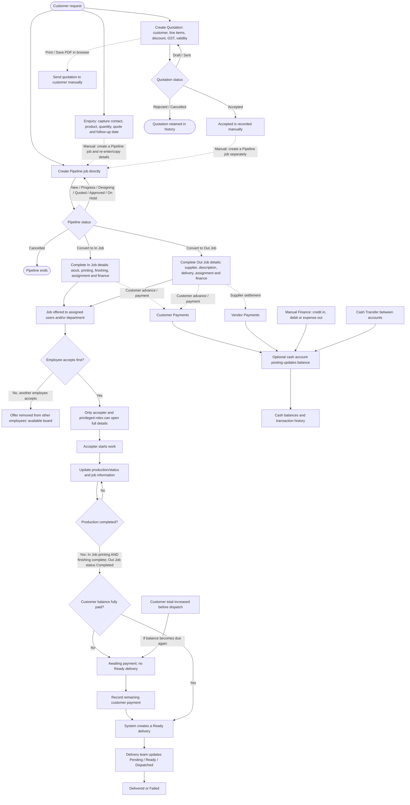
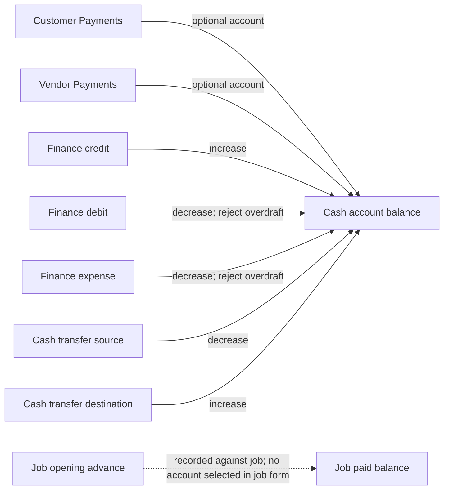

# Current Libin Prints workflow

This diagram shows the implemented paths. Quotations and Enquiries can support sales, but they are not automatically connected to Pipeline yet.



## Current module responsibilities

| Module | What happens there | Important handoff |
| --- | --- | --- |
| Enquiries | Record prospective work and a follow-up date, customer contact, job type, quantity, method, quote, and remarks. Completion is tracked as a flag. | Staff create a Pipeline job manually when ready. |
| Quotations | Create a numbered quote with customer snapshot, line items, quantity/rate, discount, GST, validity, terms, and status; print or save the saved quote as PDF. | Accepted status does not create an Enquiry or Pipeline job. Sending is manual; there is no email automation. |
| Pipeline | Track prospective jobs through New, Progress, Designing, Quoted, Approved, or On Hold. Cancelled ends it. | Convert once to either In Job or Out Job. Converted Pipeline record is marked accordingly. |
| In Jobs | Capture in-house print/stock, sheet/click, machine, finishing, customer finance, and staff/department assignment. | Printing and finishing must both be Completed. A Ready delivery is created only when the customer balance is also fully paid. |
| Out Jobs | Capture customer work, supplier (existing Supplier or manual name), job description, due date, supplier/customer finance, and assignment. | Status Completed plus full customer payment creates a Ready delivery. |
| Job Board | Shows eligible offers. Assigned employees or department members can accept. An atomic claim means only one employee accepts. | Only the accepter sees full job details and can start work. Superadmin has broad visibility. |
| Delivery | A Ready delivery is created after production is complete and customer payments cover the full job total. | Update through Dispatched and then Delivered or Failed. A failed delivery can be rescheduled by updating its date/details. |
| Finance | Posts manual Credit (cash in), Debit (cash out), or Expense (cash out) against an account. | Does not settle job balances. Use Customer Payments and Vendor Payments for those. |
| Customer Payments | Record customer receipts against an In Job or Out Job; optionally post to a cash account. | Updates job paid amount/status and, when selected, cash balance. |
| Vendor Payments | Record payments for an Out Job supplier; optionally post to a cash account. | Updates supplier paid amount/status and, when selected, cash balance. |
| Cash Transfers | Move funds between active cash accounts. | Creates transfer-out and transfer-in cash movements. |

## Assignment and visibility

```mermaid
sequenceDiagram
    participant Admin as Creator / Admin
    participant Board as Job Board
    participant Team as Assigned employees / department
    participant Winner as First accepter
    Admin->>Board: Create job and offer to users and/or department
    Board-->>Team: Show brief offer, not full job details
    Team->>Board: Compete to accept
    Board->>Board: Claim only if accepted_by is still empty
    Board-->>Winner: Acceptance succeeds; attach accepter to job
    Board-->>Team: Other claim attempts receive unavailable response
    Winner->>Board: Start work
    Board-->>Winner: Full job details; update access stays with accepter
```

The creator chooses individual users, departments, or both. A department assignment makes its members eligible; a user assignment makes those selected users eligible. Admin, Finance, and Dispatch visibility follows their existing module access. The assigned/accepted worker also needs their relevant job-module and Job Board permissions to use the offer actions.

## Finance flow



## Deployment note

The Quotations schema migration is `0018`. Apply it with `python manage.py migrate` from `backend/job` before using the new module on a database that has not received this migration. Enable the **Quotations** module in staff roles as needed. See [Quotation module notes](QUOTATIONS.md) and [Finance and supplier module notes](BUSINESS_MODULES.md).
