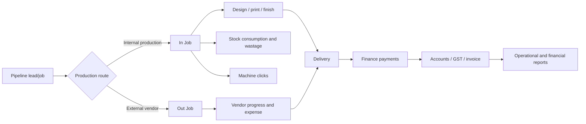

# Libin Prints — Screen, Input, Workflow, and UI Design Specification

## 1. Scope and evidence

- **Target:** `https://libinnew.vsmglobaltechnologies.com/`
- **Role observed:** Super Administrator / Super Admin
- **Analysis date:** 17 October 2026 (Asia/Calcutta)
- **Coverage:** 69 authenticated route variants, consolidated into 52 unique URL-based screen templates, plus modal-only forms.
- **Method:** authenticated, same-origin, read-only browser traversal. Only the login form was submitted. Create, update, delete, payment, assignment, status, upload, permission, and other business mutations were not submitted.
- **Data minimization:** business record rows and supplied credentials are intentionally excluded.

The requested REA workflow guided target selection, action boundaries, evidence classification, and the separation of observations from inference. The local REA MCP runtime itself was unavailable because the installed Node.js version (`22.12.0`) is below REA's supported minimum (`22.19.0`) and the Codex registration could not be read consistently. Therefore, the findings below are ordinary browser-runtime evidence and do not have REA Evidence IDs.

### Evidence ledger

| ID | Evidence | Coverage | Confidence / limitation |
|---|---|---|---|
| WEB-01 | Rendered DOM and navigation inventory | 69 authenticated route variants | High for visible fields, tables, actions, titles, and routes. |
| WEB-02 | Focused modal inspection | 13 safely opened dialogs and 48 declared dialog instances consolidated into reusable templates | High for declared fields and actions; no modal submission was performed. |
| WEB-03 | Authenticated dashboard screenshot | Shared application shell, dashboard cards, chart, alert, and activity layout | High at a 1440 × 1100 desktop viewport; responsive/mobile layouts remain untested. |
| WEB-04 | Network response metadata | Login, page documents, XHR/fetch status | Request/response bodies, credentials, and storage values were not retained. |
| WEB-05 | Negative boundary | PDF export links started downloads and were not retained | Export actions are present; generated document contents were not analyzed. |

## 2. Shared application design

### Authenticated shell

- Fixed dark left sidebar containing the Libin Prints logo and module navigation.
- White top bar containing a global **Search jobs** input, notification bell/badge, and current-user menu.
- Light-gray content canvas with a large page heading and card/table-based content.
- User menu exposes **My Assigned Jobs**, **Change Password**, and **Logout**.
- Main navigation exposes Dashboard, Pipeline, In Jobs, Out Jobs, Delivery, Stock, Customers, Machine Counter, Cash, Wastage, Finance, Accounts, Reports, Notifications, Follow-ups, Users & Roles, and Employee Permissions.
- Lists consistently use a filter area followed by a responsive data table and contextual row actions.
- Create/edit workflows use either a dedicated page or a Bootstrap-style modal with Cancel/Close and a primary submit action.
- Destructive actions are visually available to the Super Admin role; confirmation behavior was not exercised.

### Dashboard composition

- Metric cards: Total Jobs, Pipeline, Printing, Completed/Pickup, Delivered, Pending Payments, Low Stock Items, Today's Machine Clicks, Today's Job Wastage, Today's Available Cash, Today's Wastage Quantity, and Urgent/High-Priority Jobs.
- A low-stock alert carousel/toast links to filtered stock.
- A dual-axis **Last 7 Days — Jobs & Clicks** chart compares daily jobs and click counts.
- A Recent Activity feed summarizes stock, cash, job, and customer changes with actor and timestamp.
- Cards use semantic colors: blue/cyan for production, green for completion/delivery, red for risk/payment/stock, yellow for priority, and gray for neutral operational metrics.

### Global input

Every authenticated page contains the top-bar `q` search input with placeholder **Search jobs...**. It is omitted from the per-screen input lists below unless it is the screen's main filter.

## 3. End-to-end workflow design

Supporting flows:

- Customers and customer types provide reusable client master data.
- Users, departments, roles, and per-user permission overrides control work ownership and access.
- Cash is separated into Net Bank Cash, Petty Cash, and First Payment Cash.
- Notifications and assigned-job views surface operational work.
- Follow-ups track prospective or pending customer work before/alongside pipeline creation.

## 4. Screen catalog

### 4.1 Authentication and personal workspace

#### AUTH-01 — Sign In (`/`)

- **Inputs:** Username (required text, max 50), Password (required password, max 255), hidden CSRF token.
- **Actions:** Show/hide password; Sign In.
- **Feedback:** invalid submissions render an inline `Invalid username or password.` alert.
- **Design:** split-screen desktop layout with a purple product panel on the left and centered white authentication panel on the right.
- **Workflow:** browser verification → credentials → `POST /` → Dashboard on success or inline error on failure.

#### USER-01 — My Assigned Jobs (`/my-jobs.php`)

- **Inputs:** global job search only.
- **Table:** Type, Job No, Customer, Status, Assigned At.
- **Workflow:** user menu → assigned-job queue → open the applicable job detail.

#### USER-02 — Change Password (`/change_password.php`)

- **Inputs:** Current Password, New Password, Confirm Password.
- **Actions:** visibility toggles for all password fields; Update Password.
- **Workflow:** user menu → validate current password and matching new password → update credentials.

#### USER-03 — Notifications (`/notifications-list.php`)

- **Inputs:** read/unread selector and notification-type selector.
- **Actions:** Filter, Mark Read per item, Mark All Read.
- **Workflow:** notification badge/list → filter → open related object or mark notification state.

### 4.2 Dashboard

#### DASH-01 — Dashboard (`/dashboard.php`)

- **Inputs:** global search only.
- **Outputs:** operational KPI cards, low-stock alert, seven-day chart, and recent activity feed.
- **Workflow:** select **More info** on a card to enter the relevant filtered module list.
- **Design:** responsive grid of color-coded cards above chart and activity panels.

### 4.3 Pipeline

#### PIPE-01 — Pipeline Jobs (`/pipeline-list.php`)

- **Inputs:** Client/Contact/Job Type/Designer search; Status; Priority.
- **Table:** Client, Contact, Date, Job Type, Size, Qty, Printing Method, Quote, Priority, Status, Designer.
- **Actions:** Filter, open, edit, cancel, create In Job, create Out Job, upload reference files.
- **Workflow:** capture lead/specification → assign designer/status/priority → convert to In Job or Out Job.

#### PIPE-02 — Add Pipeline Job (`/pipeline-add.php`)

- **Inputs:** Client Name, Job Date, Job Type, Priority, Status, Assigned Designer, Contact Number, Size, Quantity, Printing Method, Quote, Remarks, multiple files.
- **Primary action:** Create Job.
- **Workflow:** enter customer request and quote context → optionally attach references → create pipeline record.

#### PIPE-03 — Update Pipeline Job (`/pipeline-edit.php?id={id}`)

- **Inputs:** same core fields as add, excluding file upload on the observed form.
- **Primary action:** Save.

#### PIPE-04 — Upload Reference / Example Design (`/pipeline-document-upload.php?id={id}&type=reference`)

- **Inputs:** multiple file upload.
- **Primary action:** Upload.

### 4.4 In Jobs — internal production

#### IN-01 — In Jobs (`/injobs-list.php`)

- **Inputs:** search; Priority; Printing Status; Finishing Status; row-selection checkboxes; Department; assignee multi-select.
- **Table:** Job No, Customer, Job Type, Priority, Designer, Machine, Click Count, Printing, Finishing, Payment.
- **Actions:** Filter, open/edit, move to Out Jobs, cancel, delete permanently, assign selected jobs.
- **Workflow:** filter/select work → assign department/users → progress printing and finishing → delivery/payment or move externally.

#### IN-02 — Add In Job (`/injobs-add.php`, optionally `pipeline_job_id={id}`)

- **Identity/customer:** generated file-name preview, Existing Customer, Customer Name, Contact Number, Pipeline Job, Job Date, Job Type, Priority.
- **Paper/production:** Stock Item, Paper Type, GSM, Paper Size, Quantity, Side Mode, Sheet Count, calculated Click Count, Wastage Count, Printer, Designer, Machine.
- **Finishing:** Lamination Type, Regular/Corner options, Binding Method.
- **Delivery:** LP Office, Porter, Courier.
- **Financial:** Total Amount, Advance, calculated Balance, calculated Profit, Payment Status, Invoice No, GST Percent.
- **Other:** General Remarks; job-type quick-add; user/department assignment selector.
- **Primary action:** Create Job.
- **Workflow:** choose customer/pipeline → define material and print specification → calculate sheets/clicks → choose machine/designer/finish/delivery → enter commercial values → create.

#### IN-03 — In Job Detail (`/injobs-view.php?id={id}`)

- **Inputs:** none in the observed detail state.
- **Actions:** edit, upload design, log wastage, move to Out Jobs, mark finishing completed, cancel.
- **Workflow:** review full job state → perform production-related subflow → advance or reroute job.

#### IN-04 — Edit In Job (`/injobs-edit.php?id={id}`)

- **Inputs:** Customer, Job Date, File Name, Job Type, Priority, Contact, Stock/Paper/GSM/Size, Quantity, Side Mode, Sheet/Click/Wastage counts, Designer, Machine, Printing Status, Lamination, Regular/Corner, Binding, Finishing Status, delivery methods, Total, Advance, Payment Status, Invoice No, Remarks.
- **Primary action:** Save.

#### IN-05 — Upload Design File (`/injobs-design-upload.php?id={id}`)

- **Inputs:** Design File.
- **Primary action:** Upload.

### 4.5 Out Jobs — external/vendor production

#### OUT-01 — Out Jobs (`/outjobs-list.php`)

- **Inputs:** search; Priority; Status; row-selection checkboxes; Department; assignee multi-select.
- **Table:** Job No, Customer, Vendor, Priority, Quantity, Status, Delivery Date, Payment.
- **Actions:** Filter, open/edit, move to In Jobs, cancel, delete permanently, assign selected jobs.

#### OUT-02 — Add Out Job (`/outjobs-add.php`, optionally `pipeline_job_id={id}`)

- **Customer/vendor:** Existing Customer, Customer Name, Contact, Vendor, Job Type, Supplier Expenses.
- **Production:** Status, Priority, Description, Quantity, Delivery Date.
- **Delivery:** LP Office, Porter, Courier; Remarks.
- **Customer financials:** Total Amount, Advance, calculated Balance, Expenses, calculated Profit, Payment Status, Invoice No, GST Percent.
- **Vendor financials:** Vendor Total Payment, Vendor Advance, calculated Vendor Balance, Vendor Payment Status.
- **Primary action:** Create Job.

#### OUT-03 — Out Job Detail (`/outjobs-view.php?id={id}`)

- **Inputs:** none in the observed detail state.
- **Actions:** edit, delivery/payment-related navigation, move to In Jobs, cancel.

#### OUT-04 — Edit Out Job (`/outjobs-edit.php?id={id}`)

- **Inputs:** Customer, Contact, Vendor, Supplier Expenses, Job Type, Status, Priority, Description, Quantity, Delivery Date, Transport Details, delivery methods, Remarks, customer totals/advance/payment/invoice, vendor totals/advance/balance/payment status.
- **Primary action:** Save.

### 4.6 Delivery

#### DEL-01 — Delivery List (`/delivery-list.php`)

- **Inputs:** Job/Customer/Contact/Job Type search; Source; Status. A delivered-only variant uses `view=delivered`.
- **Table:** Job No, Job, Customer, Job Type, Method, Amount, Payment, Status, Delivery Date.
- **Workflow:** filter pending/delivered work → open a job's delivery editor → record logistics and status.

#### DEL-02 — Delivery Editor (`/delivery-edit.php?job_type={type}&job_id={id}`)

- **Inputs:** Delivery Date, Status, Address, Contact Person, Contact Number, Method, Transport Company, Delivery Charges, Instructions.
- **Primary action:** Save Delivery.

### 4.7 Stock

#### STOCK-01 — Stock List (`/stock-list.php`)

- **Inputs:** item search, Category, Low Stock Only, inline minimum-stock values.
- **Table:** Name, Category, Color, GSM, Size, Current Stock, Min Stock, Unit.
- **Actions:** Filter, Add Stock Item, update minimum stock, adjust/view history, edit, delete, bulk upload. A low-stock variant uses `low_stock=1`.

#### STOCK-02 — Add Stock Item (modal)

- **Inputs:** Name, Category, Color, GSM, Size, Opening Stock, Minimum Stock, Unit.
- **Primary action:** Add Item.

#### STOCK-03 — Edit Stock Item (modal)

- **Inputs:** Name, Category, Color, GSM, Size, Minimum Stock, Unit.
- **Primary action:** Save Changes.

#### STOCK-04 — Stock History (`/stock-view.php?id={id}`)

- **Table:** Date, Type, Qty, Balance After, Reason, By.
- **Workflow:** audit every adjustment and resulting balance.

#### STOCK-05 — Adjust Stock (`/stock-adjust.php?id={id}`)

- **Inputs:** Adjustment Type, Quantity, Reason.
- **Primary action:** Apply.

#### STOCK-06 — Bulk Upload Stock (`/stock-bulk-upload.php`)

- **Inputs:** Stock spreadsheet/file.
- **Primary action:** Upload & Validate.
- **Related action:** template download is present; its downloaded content was not inspected.

### 4.8 Customers and follow-ups

#### CUST-01 — Customers (`/customers-list.php`)

- **Inputs:** Name/Mobile search; Customer Type.
- **Table:** Name, Mobile, GST Number, Type, Address.
- **Actions:** Search, Add Customer, Edit, Delete.

#### CUST-02 — Add/Edit Customer (modals)

- **Inputs:** Name, Mobile, GST Number, Address, Customer Type.
- **Primary actions:** Create Customer or Save Changes.

#### CUST-03 — Manage Customer Types (`/customer-types-list.php`)

- **Inputs:** customer-type search.
- **Table:** Name, Status.
- **Actions:** Add Customer Type, Activate, Deactivate.

#### CUST-04 — Add Customer Type (modal)

- **Input:** Name.
- **Primary action:** Add Customer Type.

#### FOLLOW-01 — Follow Up (`/followups-list.php`)

- **Inputs:** Customer search; Printing Method.
- **Table:** Date, Customer, Job Type, Size, Qty, Printing Method, Quote, Remarks.
- **Actions:** Search, Add Follow Up, Edit, Delete.

#### FOLLOW-02 — Add/Edit Follow Up (modals)

- **Inputs:** Follow-up Date, Customer Name, Job Type, Size, Quantity, Printing Method, Quote, Remarks.
- **Primary actions:** Add Follow Up or Save Changes.

### 4.9 Machine counter

#### MACH-01 — Machine Counter (`/machine-list.php`)

- **Operational status inputs:** per-machine Status and required Reason when stopped/broken down.
- **Counter inputs:** date and morning/ending count fields for the displayed machines.
- **Tables:** machine status; operator/morning/ending/actual/job-booked/difference; count-entry table; historical counter log.
- **Actions:** Update operational state; Save counts; Edit reading; Manage Machines.

#### MACH-02 — Manage Machines (`/machine-machines.php`)

- **Table:** Code, Name, Location, Status, Default.
- **Actions:** Add Machine, Edit, Delete.

#### MACH-03 — Add Machine (modal)

- **Inputs:** Code, Name, Location, Set as Default Machine.
- **Primary action:** Add Machine.

#### MACH-04 — Edit Machine (modal)

- **Inputs:** Code, Name, Location, Status, Set as Default Machine.
- **Primary action:** Save Changes.

#### MACH-05 — Edit Machine Count (`/machine-counter-edit.php?id={id}`)

- **Inputs:** Count Date, Morning Count, Ending Count.
- **Primary action:** Save.

### 4.10 Wastage

#### WASTE-01 — Wastage Management (`/wastage-list.php`)

- **Inputs:** search; Machine; From Date; To Date.
- **Tables:** job-derived wastage and manually recorded wastage.
- **Columns:** job/date/customer/type/printer/machine/sheets/wastage/update; and date/type/quantity/machine/job/reason/recorded by.
- **Actions:** Filter, Log Wastage, Delete.

#### WASTE-02 — Log Wastage (`/wastage-add.php`, optionally linked to a job)

- **Inputs:** Wastage Type, Quantity, Machine, Wastage Date, Reason.
- **Primary action:** Log Wastage.

### 4.11 Cash

#### CASH-01 — Cash Management (`/cash-list.php`)

- **Tabs:** Cash 1 — Net Bank Cash; Cash 2 — Petty Cash; Cash 3 — First Payment Cash.
- **Observed Net Bank inputs:** Entry Date, existing customer selector, Customer Name, Job Name/Reference, Amount, Remarks.
- **Observed transfer/filter inputs:** transfer Amount and Reason; From/To dates.
- **Tables:** Customer/Job/Amount/By and Date/Type/Description/Amount/By.
- **Actions:** Add Transaction, Withdraw from Net Bank, Add to Petty Cash, Edit, Delete, Filter.
- **Workflow:** select cash bucket → record receipt/expense/transfer → reconcile running history → report.

#### CASH-02 — Declared edit dialogs

| Dialog | Inputs |
|---|---|
| Edit Net Bank Transaction | Entry Date, Customer Name, Job Name, Amount, Remarks |
| Edit Net Bank Withdrawal | Transfer Date, Amount, Reason |
| Edit Petty Expense | Expense Date, Amount, Reason, Remarks |
| Edit Petty Cash Entry | Entry Date, Amount, Remarks |
| Edit Customer Payment | Payment Date, Customer Name, Amount, Remarks |
| Edit Cash 3 Expense | Expense Date, Amount, Reason, Remarks |

### 4.12 Finance and accounts

#### FIN-01 — Finance (`/finance-list.php`)

- **Customer payment inputs:** Job/Customer/Invoice search; Payment Status.
- **Vendor payment inputs:** Job/Supplier search; Vendor Payment Status.
- **Tables:** customer balances; vendor balances; payment history.
- **Actions:** filter and open a payment-recording flow.

#### FIN-02 — Record Payment (`/finance-record-payment.php?job_type={type}&job_id={id}`)

- **Inputs:** Amount (required), Type, Payment Date (required), Method, Reference No.
- **History table:** Date, Amount, Type, Method, Recorded By.
- **Primary action:** Record Payment.

#### ACC-01 — Accounts (`/accounts-list.php`)

- **Inputs:** Job/Customer/Invoice/Contact search; Payment Status; Sort; Direction.
- **Table:** Job No, Date, Job Type, Customer, Contact, Total, GST %, GST Amount, Grand Total, Balance, Invoice No, Payment Status, Action.
- **Actions:** Apply, View, Edit Invoice/GST.

#### ACC-02 — Job Account View (modal)

- **Inputs:** none observed.
- **Purpose:** display a selected job's accounting breakdown without leaving the list.

#### ACC-03 — Edit Invoice/GST (modal)

- **Inputs:** Invoice Number, GST Percent.
- **Primary action:** save invoice/tax changes.

### 4.13 Reports

#### REPORT-01 — Reports Hub (`/reports-list.php`)

- **Inputs:** global search only.
- **Workflow:** select a report card → apply date/entity filters → inspect table → optionally export PDF.

| ID | Route | Filters | Output columns |
|---|---|---|---|
| REPORT-02 Daily | `/reports-daily.php` | Date | Type, Job No, Customer, Job Type, Printer, Qty, Sheets, Clicks, Status, Job Amount, Payment |
| REPORT-03 Monthly | `/reports-monthly.php` | Month | Day, Jobs, Sheets, Clicks, Revenue |
| REPORT-04 Production | `/reports-production.php` | From, To | Job No, Date, Customer, Type, Priority, Qty, Sheets, Clicks, Status, Job Value, Payment |
| REPORT-05 User Performance | `/reports-user-performance.php` | From, To | User, Role, Jobs, Total Clicks |
| REPORT-06 Machine Usage | `/reports-machine-usage.php` | From, To | Date, Machine, Operator, Morning, Ending, Actual Clicks, Job Clicks, Difference |
| REPORT-07 Stock & Consumption | `/reports-stock.php` | From, To | Item, Category, Current Stock, Min Stock, Consumed, Restocked |
| REPORT-08 Customer | `/reports-customer.php` | None observed | Customer, Jobs, Total Qty, Total Amount, Outstanding Balance |
| REPORT-09 Out Job | `/reports-out-job.php` | None observed | Job No, Customer, Vendor, Qty, Status, Total, Advance, Balance, Payment Status, Delivery Date |
| REPORT-10 Delivery | `/reports-delivery.php` | None observed | Job No, Type, Customer, Delivery Date, Transport, Status |
| REPORT-11 Pending Jobs | `/reports-pending.php` | None observed | Separate pending In/Out tables: Job No, Customer, Date, Status |
| REPORT-12 Wastage | `/reports-wastage.php` | From, To, Machine | Job-linked and manual wastage tables |
| REPORT-13 Finance/Payment | `/reports-finance.php` | From, To | Date, Job, Amount, Type, Method |
| REPORT-14 Cash | `/reports-cash.php` | From, To | Date, Opening, Expenses, Withdrawals, Available |

Each report exposes a PDF export route. Export presence was observed, but generated PDF contents were not downloaded or analyzed.

### 4.14 Users, departments, and permissions

#### ADMIN-01 — Users & Roles (`/users-list.php`)

- **Inputs:** Name/Username/Email search; Role; Status.
- **Table:** Full Name, Username, Role, Department, Status, Created.
- **Actions:** Search, Add User, Edit, Delete, Delete All Inactive, Manage Departments.

#### ADMIN-02 — Add User (modal)

- **Inputs:** Username, Full Name, Email, Role, Department, Password.
- **Primary action:** Create User.

#### ADMIN-03 — Edit User (modal)

- **Inputs:** Full Name, Email, Role, Department, Status, New Password.
- **Primary action:** Save Changes.

#### ADMIN-04 — Manage Departments (`/departments-list.php`)

- **Inputs:** department search.
- **Table:** Name, Slug.
- **Actions:** Add Department, Delete.

#### ADMIN-05 — Add Department (modal)

- **Input:** Name.
- **Primary action:** Add Department.

#### ADMIN-06 — Employee Permissions (`/permissions-list.php`)

- **Inputs:** employee search.
- **Purpose:** select an employee to inspect or override module-level permissions.

#### ADMIN-07 — Employee Permission Detail (`/permissions-list.php?user_id={id}`)

- **Per-module selectors:** Dashboard, Pipeline, In Jobs, Out Jobs, Delivery, Stock, Customers, Machine, Cash, Wastage, Finance, Accounts, Reports, Notifications, Follow-ups, Users, Permissions.
- **Table:** Module, Role Default, Employee Override, Effective Access.
- **Actions:** Save Permissions; Reset All to Role Default.
- **Workflow:** select employee → compare role default with override/effective access → save overrides or reset.

## 5. Important behavioral observations

1. The application models two production routes: internal **In Jobs** and vendor-based **Out Jobs**, with explicit movement between them.
2. Pipeline records can seed either job type, preserving early customer/specification context.
3. In Jobs combine production, material, machine, finishing, delivery, finance, and assignment data in one large form.
4. Out Jobs add vendor expense and vendor-payment tracking.
5. Delivery is a cross-job workflow selected by `job_type` and `job_id`.
6. Stock, machine clicks, and wastage support operational reconciliation against booked jobs.
7. Finance records payments; Accounts manages GST/invoice presentation and outstanding balances.
8. Permissions use role defaults plus per-employee overrides, producing an explicit effective-access result.
9. The Super Admin UI exposes destructive actions. Their confirmation, authorization enforcement, audit logging, and server-side validation were not tested.

## 6. Unresolved and intentionally untested areas

- No mutation was submitted, so success messages, server-side validations, duplicate handling, transactional integrity, and downstream state changes remain unverified.
- Delete/cancel/move/mark/assign/status/permission/payment/upload actions were inventoried but not executed.
- PDF and spreadsheet/template download contents were not retained.
- Mobile and tablet responsive behavior, keyboard-only operation, screen-reader quality, and cross-browser compatibility were not tested.
- Role-specific differences other than Super Admin remain unknown.
- Security testing—authorization bypass, CSRF effectiveness, session lifetime, rate limiting, input sanitization, and file-upload safety—was outside this documentation pass.

